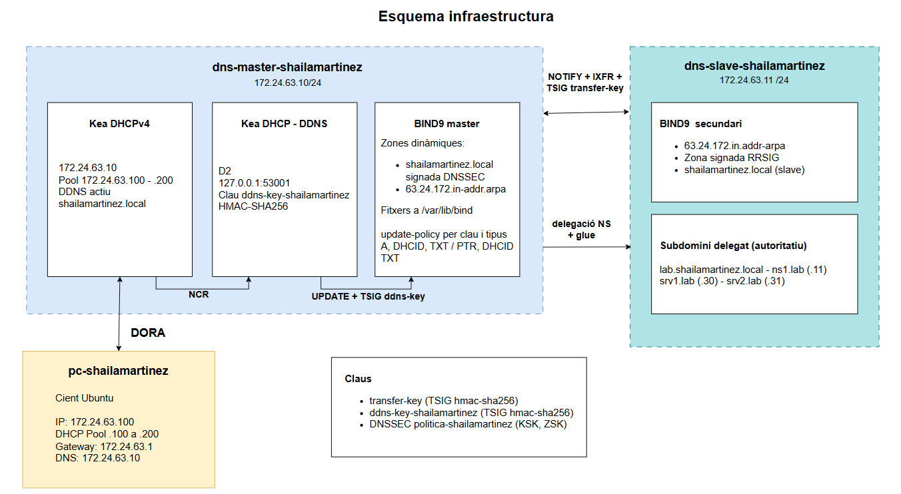

# DNS Dinàmic, Delegació i DNSSEC amb BIND9 i Kea

**Shaila Martínez - 2n ASIX**

**Nº 63 - Serveis**

Master 172.24.63.10, Slave 172.24.63.11, Client pc-shailamartinez (DHCP 172.24.63.100-200)

## Part 0: Punt de partida

```bash
sudo named-checkconf
dig @172.24.63.10 www.shailamartinez.local +short
dig @172.24.63.10 -x 172.24.63.20 +short
dig @172.24.63.11 www.shailamartinez.local +short
sudo named-checkconf && sudo systemctl restart bind9
dig @172.24.63.11 -x 172.24.63.20 +short
```
Comprovo que la PR0375/01/01 continua funcionant. Al master deixo la zona inversa igual que la directa (`allow-transfer` i `also-notify` amb la `transfer-key`) i al slave l'afegeixo com a `slave`. Reinicio BIND9 a les dues màquines i el slave resol el PTR de `www`.

## Part 1: Delegació del subdomini lab

```bash
sudo mkdir -p /etc/bind/zones
sudo nano /etc/bind/named.conf.local
sudo nano /etc/bind/zones/db.lab.shailamartinez.local
sudo named-checkzone lab.shailamartinez.local /etc/bind/zones/db.lab.shailamartinez.local
sudo systemctl restart bind9
dig @172.24.63.11 srv1.lab.shailamartinez.local
```
Al slave creo la zona `lab.shailamartinez.local` com a `master` amb `allow-transfer { none; }`, amb `ns1`, `srv1` i `srv2`. Amb `dig` surt el flag `aa`.

```bash
sudo nano /etc/bind/zones/db.shailamartinez.local
sudo nano /etc/bind/named.conf.options
sudo named-checkzone shailamartinez.local /etc/bind/zones/db.shailamartinez.local
sudo named-checkconf && sudo systemctl restart bind9
dig @172.24.63.10 srv1.lab.shailamartinez.local +norecurse
dig @172.24.63.10 srv1.lab.shailamartinez.local
dig @172.24.63.10 lab.shailamartinez.local NS
```
Al master afegeixo la delegació (`lab IN NS ns1.lab...` i el registre de cola `ns1.lab IN A 172.24.63.11`), pujo el serial i poso `validate-except { "shailamartinez.local"; };` perquè no validi el domini intern. Amb `+norecurse` la resposta és una derivació: sense `aa`, el NS a AUTHORITY i el glue a ADDITIONAL. Sense `+norecurse`, el master segueix la delegació i retorna la IP de `srv1`.

## Part 2: Zona dinàmica i nsupdate

```bash
sudo cp /etc/bind/zones/db.shailamartinez.local /var/lib/bind/
sudo cp /etc/bind/zones/db.172.24.63 /var/lib/bind/
sudo chown bind:bind /var/lib/bind/db.*
tsig-keygen -a hmac-sha256 ddns-key-shailamartinez | sudo tee /etc/bind/ddns.key
sudo chown root:bind /etc/bind/ddns.key
sudo chmod 640 /etc/bind/ddns.key
sudo nano /etc/bind/named.conf.options
sudo nano /etc/bind/named.conf.local
sudo named-checkconf && sudo systemctl restart bind9
sudo journalctl -u named -n 20 --no-pager
```
Les zones es mouen a `/var/lib/bind` (AppArmor només deixa escriure-hi). Genero una clau pròpia `ddns-key-shailamartinez`, diferent de la `transfer-key`, amb permisos 640. A cada zona afegeixo una `update-policy`: a la directa només A, DHCID i TXT, i a la inversa PTR, DHCID i TXT. També afegeixo el canal de log `update_log`.

```bash
sudo nsupdate -k /etc/bind/ddns.key
dig @172.24.63.10 prova-nsupdate.shailamartinez.local +short
dig @172.24.63.10 shailamartinez.local SOA +short
nsupdate
sudo tail -n 20 /var/log/bind/update.log
```
Creo `prova-nsupdate` (A i PTR) sense editar cap fitxer i el serial puja sol (2026101359 → 2026101360). Sense clau des de l'slave surt `REFUSED`, i amb clau però amb un MX també `REFUSED`. A `update.log` es veuen els dos intents.

```bash
sudo rndc freeze shailamartinez.local
sudoedit /var/lib/bind/db.shailamartinez.local
sudo rndc thaw shailamartinez.local
```
Per editar a mà faig `freeze`, afegeixo el TXT `prova-manual`, pujo el serial i faig `thaw`.

## Part 3: DNS dinàmic amb Kea

```bash
sudo apt install -y kea-dhcp-ddns-server
sudo nano /etc/kea/kea-dhcp-ddns.conf
sudo chown root:_kea /etc/kea/kea-dhcp-ddns.conf
sudo chmod 640 /etc/kea/kea-dhcp-ddns.conf
sudo kea-dhcp-ddns -t /etc/kea/kea-dhcp-ddns.conf
sudo systemctl enable --now kea-dhcp-ddns-server
```
Instal·lo el D2 i hi poso la clau `ddns-key-shailamartinez` amb el mateix secret que el BIND, els dominis directe i invers apuntant al `172.24.63.10` i el log a `kea-ddns.log`. El fitxer queda `root:_kea` 640 perquè conté el secret.

```bash
sudo nano /etc/kea/kea-dhcp4.conf
sudo kea-dhcp4 -t /etc/kea/kea-dhcp4.conf
sudo systemctl restart kea-dhcp4-server
```
Al `kea-dhcp4.conf` afegeixo el bloc `dhcp-ddns` i els paràmetres `ddns-*` amb el sufix `shailamartinez.local.`.

```bash
sudo hostnamectl set-hostname pc-shailamartinez
sudo dhclient -r enp0s3 && sudo dhclient -v enp0s3
sudo tail -n 20 /var/log/kea/kea-ddns.log
dig @172.24.63.10 pc-shailamartinez.shailamartinez.local
dig @172.24.63.10 -x 172.24.63.100
dig @172.24.63.10 pc-shailamartinez.shailamartinez.local DHCID
dig @172.24.63.11 pc-shailamartinez.shailamartinez.local +short
sudo journalctl -u named --since "10 min ago" | grep -iE "notify|transfer|IXFR"
sudo dhclient -r enp0s3
```
El client obté la `172.24.63.100` i al log del D2 surt `DHCP_DDNS_ADD_SUCCEEDED`. Al master existeixen l'A, el PTR i el DHCID, i el slave ho resol sense cap acció manual (es veuen els `notify` i les transferències amb la `transfer-key`). En alliberar la concessió, `DHCP_DDNS_REMOVE_SUCCEEDED` i els registres desapareixen.

## Part 4: Signatura DNSSEC

```bash
dig @172.24.63.10 isc.org A +dnssec
dig @172.24.63.10 dnssec-failed.org A
dig @172.24.63.10 dnssec-failed.org A +cd
```
`isc.org` surt amb el flag `ad`, `dnssec-failed.org` dona `SERVFAIL` i amb `+cd` ja respon.

```bash
sudo nano /etc/bind/named.conf.options
sudo mkdir -p /var/lib/bind/keys
sudo chown bind:bind /var/lib/bind/keys
sudo nano /etc/bind/named.conf.local
sudo named-checkconf && sudo rndc reconfig
sudo rndc dnssec -status shailamartinez.local
ls -l /var/lib/bind/keys
```
Creo la `dnssec-policy "politica-shailamartinez"` (KSK sense caducitat, ZSK de 30 dies, NSEC3 i `max-zone-ttl 604800` perquè la zona usa TTL de 7 dies). A la zona directa poso `key-directory`, `dnssec-policy` i `inline-signing no`. BIND genera la ZSK (49445) i la KSK (48299) i signa la zona.

```bash
dig @172.24.63.10 shailamartinez.local DNSKEY +multi
dig @172.24.63.10 www.shailamartinez.local A +dnssec
dig @172.24.63.10 noexisteix.shailamartinez.local A +dnssec
dig @172.24.63.10 pc-shailamartinez.shailamartinez.local A +dnssec
dig @172.24.63.11 www.shailamartinez.local A +dnssec
sudo rndc sync -clean shailamartinez.local
sudo dnssec-verify -o shailamartinez.local /var/lib/bind/db.shailamartinez.local
dig @172.24.63.10 shailamartinez.local DNSKEY | dnssec-dsfromkey -f - shailamartinez.local
```
Comprovo les dues DNSKEY, els RRSIG al master i a l'slave, el NSEC3 d'un nom inexistent, el RRSIG del registre creat pel DHCP, `Zone fully signed` amb `dnssec-verify` i obtinc el DS de la KSK.

## Procediment d'operació

**Afegir un registre manual a la zona dinàmica**

Amb `nsupdate` (no cal tocar cap fitxer):
```bash
sudo nsupdate -k /etc/bind/ddns.key
server 172.24.63.10
zone shailamartinez.local
update add nom.shailamartinez.local. 300 A 172.24.63.X
send
```
La `update-policy` només deixa A, DHCID i TXT a la directa, i PTR, DHCID i TXT a la inversa. Per altres tipus (MX, NS...) cal editar el fitxer:
```bash
sudo rndc freeze shailamartinez.local
sudoedit /var/lib/bind/db.shailamartinez.local
sudo rndc thaw shailamartinez.local
```
Cal pujar el serial abans del `thaw` i no editar mai el fitxer sense `freeze`.

**Comprovar que el DDNS funciona**

```bash
sudo systemctl status kea-dhcp4-server kea-dhcp-ddns-server
sudo tail -n 20 /var/log/kea/kea-ddns.log
dig @172.24.63.10 pc-shailamartinez.shailamartinez.local
dig @172.24.63.11 pc-shailamartinez.shailamartinez.local +short
sudo tail -n 20 /var/log/bind/update.log
```
Cada actualització correcta deixa `DHCP_DDNS_ADD_SUCCEEDED` (i `DHCP_DDNS_REMOVE_SUCCEEDED` en alliberar). Si surt `REFUSED`, revisar la `update-policy`, si surt `TSIG verify failed` o `NOTAUTH`, el nom o el secret de la clau no coincideixen entre Kea i BIND.

**Consultar l'estat de les claus DNSSEC**

```bash
sudo rndc dnssec -status shailamartinez.local
ls -l /var/lib/bind/keys
dig @172.24.63.10 shailamartinez.local DNSKEY +multi
sudo rndc sync -clean shailamartinez.local
sudo dnssec-verify -o shailamartinez.local /var/lib/bind/db.shailamartinez.local
```
La ZSK es renova cada 30 dies (el `rndc dnssec -status` mostra el proper rollover) i la KSK no caduca.

## Esquema infraestructura


